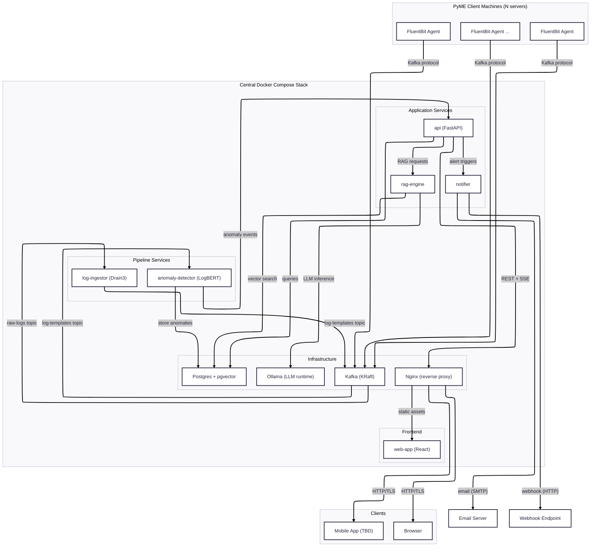
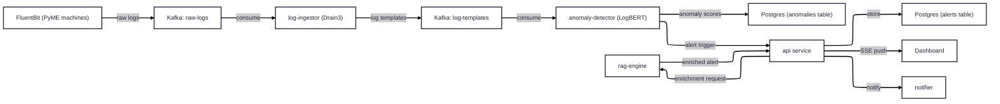
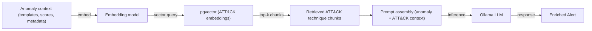
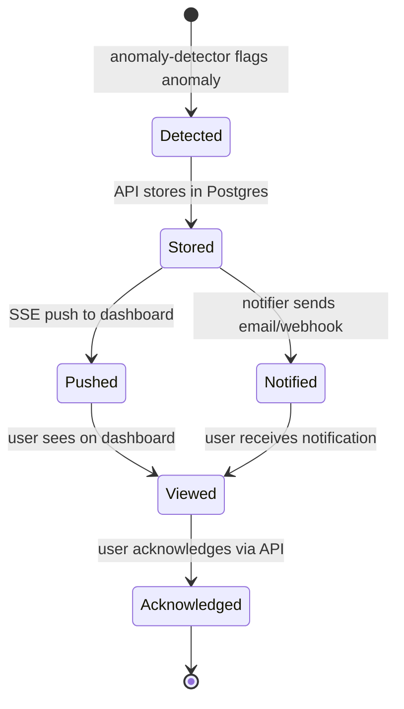

# Anomaly Watch — Architecture

**Anomaly Watch** is a self-hosted, microservices-based log anomaly detection platform designed for PyMEs (small and medium enterprises). It collects logs from client machines, applies ML-based anomaly detection, and generates enriched alerts with MITRE ATT&CK-mapped explanations and contingency actions using a local RAG pipeline.

**Deployment model:** A single Docker Compose stack runs on the PyME's central server. FluentBit agents installed on each PyME machine forward logs to the central stack via Kafka.

**Date of last update:** 2026-06-07

---

## Table of Contents

- [1. System Architecture Diagram](#1-system-architecture-diagram)
- [2. Service Catalog](#2-service-catalog)
  - [2.1 Infrastructure Services](#21-infrastructure-services)
  - [2.2 Pipeline Services](#22-pipeline-services)
  - [2.3 Application Services](#23-application-services)
  - [2.4 Frontend](#24-frontend)
- [3. Data Pipeline](#3-data-pipeline)
  - [3.1 Pipeline Flow Diagram](#31-pipeline-flow-diagram)
  - [3.2 Kafka Topic Structure](#32-kafka-topic-structure)
  - [3.3 Drain3 Template Extraction](#33-drain3-template-extraction)
  - [3.4 LogBERT Anomaly Detection](#34-logbert-anomaly-detection)
- [4. RAG Response Engine](#4-rag-response-engine)
  - [4.1 RAG Pipeline Flow](#41-rag-pipeline-flow)
  - [4.2 MITRE ATT&CK Knowledge Base Ingestion](#42-mitre-attck-knowledge-base-ingestion)
  - [4.3 Enriched Alert Structure](#43-enriched-alert-structure)
  - [4.4 LLM Model](#44-llm-model)
- [5. Real-Time Alerts & Notifications](#5-real-time-alerts--notifications)
  - [5.1 SSE Real-Time Updates](#51-sse-real-time-updates)
  - [5.2 Notification Channels](#52-notification-channels)
  - [5.3 Alert Lifecycle](#53-alert-lifecycle)
- [6. Auth & Security](#6-auth--security)
  - [6.1 Authentication](#61-authentication)
  - [6.2 RBAC Roles](#62-rbac-roles)
  - [6.3 Security Considerations](#63-security-considerations)
- [7. Infrastructure & Deployment](#7-infrastructure--deployment)
  - [7.1 Docker Compose Topology](#71-docker-compose-topology)
  - [7.2 FluentBit Agent Deployment](#72-fluentbit-agent-deployment)
  - [7.3 Development Environment](#73-development-environment)
- [8. Data Stores](#8-data-stores)
  - [8.1 Postgres Schema Areas](#81-postgres-schema-areas)
  - [8.2 pgvector for ATT&CK Embeddings](#82-pgvector-for-attck-embeddings)
  - [8.3 Log Retention Policy](#83-log-retention-policy)
- [9. TBD Items](#9-tbd-items)
- [10. Glossary](#10-glossary)

---

## 1. System Architecture Diagram

C4-style system context diagram showing all major components and their interactions:

**Protocol legend:**
- **Kafka protocol** — FluentBit → Kafka, inter-service messaging
- **REST** — API ↔ frontend clients, API ↔ rag-engine
- **SSE** — API → frontend clients (real-time push)
- **Internal** — rag-engine ↔ Ollama, rag-engine ↔ Postgres (pgvector)
- **SMTP/HTTP** — notifier → email servers / webhook endpoints

---

## 2. Service Catalog

### 2.1 Infrastructure Services

| Service | Technology | Responsibility | Default Port |
|---------|-----------|---------------|-------------|
| **kafka** | Apache Kafka (KRaft mode, no ZooKeeper) | Message broker for inter-service log pipeline communication | 9092 |
| **postgres** | PostgreSQL + pgvector extension | Primary data store for templates, anomalies, alerts, users, and ATT&CK embeddings | 5432 |
| **nginx** | Nginx | Reverse proxy, TLS termination, static file serving for web-app | 80 / 443 |
| **ollama** | Ollama | Local LLM runtime for RAG inference. Runs as container, serves model via HTTP API | 11434 |

### 2.2 Pipeline Services

| Service | Technology | Responsibility | Default Port |
|---------|-----------|---------------|-------------|
| **log-ingestor** | Python / Drain3 | Consumes raw logs from Kafka, extracts parameterized log templates using Drain3 algorithm, publishes templates to Kafka | — (consumer) |
| **anomaly-detector** | Python / LogBERT | Consumes log templates from Kafka, runs LogBERT inference to score template sequences, flags anomalies above threshold, triggers alerts | — (consumer) |

### 2.3 Application Services

| Service | Technology | Responsibility | Default Port |
|---------|-----------|---------------|-------------|
| **api** | Python / FastAPI | REST API + SSE endpoints. Central gateway for frontend, alert management, user auth, and coordination with rag-engine | 8000 |
| **rag-engine** | Python / pgvector + Ollama | RAG pipeline: embeds anomaly context, searches pgvector for MITRE ATT&CK matches, sends prompt to Ollama LLM, returns enriched alert | 8001 |
| **notifier** | Python | Notification dispatch service. Sends alerts via email (SMTP) and webhook (HTTP POST). Additional channels TBD | 8002 |

### 2.4 Frontend

| Service | Technology | Responsibility | Default Port |
|---------|-----------|---------------|-------------|
| **web-app** | React | Real-time anomaly dashboard. Receives SSE events for live updates, displays alerts, ATT&CK mappings, and contingency plans | 3000 (dev) |
| **mobile app** | **TBD** (React Native / Flutter / PWA+Capacitor) | Mobile interface for alert monitoring and acknowledgment | TBD |

---

## 3. Data Pipeline

### 3.1 Pipeline Flow Diagram

### 3.2 Kafka Topic Structure

| Topic | Producer | Consumer | Payload |
|-------|----------|----------|---------|
| `raw-logs` | FluentBit agents | log-ingestor | Raw log lines with metadata (source host, timestamp, log level) |
| `log-templates` | log-ingestor | anomaly-detector | Parameterized log templates with template ID, cluster ID, and extracted parameters |

Additional topics may be added as the system evolves (e.g., `anomaly-events` for decoupling detection from alerting).

### 3.3 Drain3 Template Extraction

The **log-ingestor** service uses the [Drain3](https://github.com/logpai/Drain3) algorithm to parse raw log messages into parameterized templates. Drain3 uses a fixed-depth tree structure for efficient online log parsing.

**Example:**

| Stage | Content |
|-------|---------|
| **Raw log** | `2026-06-07 14:23:01 INFO User admin logged in from 192.168.1.50` |
| **Extracted template** | `User <*> logged in from <*>` |
| **Parameters** | `["admin", "192.168.1.50"]` |

The template extraction enables LogBERT to work with normalized log sequences rather than high-cardinality raw text, dramatically reducing the vocabulary space and improving anomaly detection accuracy.

### 3.4 LogBERT Anomaly Detection

The **anomaly-detector** service uses [LogBERT](https://arxiv.org/abs/2103.04475), a BERT-based model adapted for log anomaly detection.

**Training flow:**
- Training infrastructure: **TBD** (local GPU / cloud GPU / pre-trained weights)
- Input: historical log template sequences (normal behavior baseline)
- Output: trained model weights for inference

**Inference flow (real-time):**
1. Consume log template sequences from `log-templates` Kafka topic
2. Encode template sequences using LogBERT tokenizer
3. Run inference on **CPU** (no GPU required for inference)
4. Compute anomaly score for each sequence
5. If score exceeds configurable threshold → flag as anomaly → trigger alert pipeline

---

## 4. RAG Response Engine

### 4.1 RAG Pipeline Flow

When an anomaly is detected, the RAG engine enriches the alert with explanations and contingency plans:

**Flow steps:**
1. **Anomaly context** — anomaly-detector provides the anomaly description, involved log templates, anomaly score, and source metadata
2. **Embedding** — anomaly context is embedded into a vector representation
3. **pgvector search** — similarity search against MITRE ATT&CK embeddings in Postgres, returning top-k most relevant technique/tactic chunks
4. **Prompt assembly** — anomaly context + retrieved ATT&CK chunks are combined into a structured prompt
5. **LLM inference** — Ollama generates an explanation including ATT&CK technique mapping and suggested contingency actions
6. **Enriched alert** — structured response is returned to the API for storage and delivery

### 4.2 MITRE ATT&CK Knowledge Base Ingestion

The MITRE ATT&CK framework data is ingested into pgvector for retrieval:

1. **Source** — MITRE ATT&CK Enterprise matrix (techniques, tactics, procedures)
2. **Chunking** — Each technique/sub-technique is split into chunks (description, detection guidance, mitigations)
3. **Embedding** — Chunks are embedded using a sentence transformer model
4. **Storage** — Embeddings stored in Postgres using the `pgvector` extension with IVFFlat or HNSW indexing
5. **Update cadence** — Re-ingestion on MITRE ATT&CK version updates (manual trigger)

### 4.3 Enriched Alert Structure

Each enriched alert produced by the RAG pipeline contains:

| Field | Description |
|-------|-------------|
| `anomaly_description` | Human-readable summary of what was detected (templates, scores, affected hosts) |
| `attack_techniques` | List of matched MITRE ATT&CK techniques with IDs (e.g., T1078 — Valid Accounts) |
| `attack_tactics` | Associated tactics (e.g., Initial Access, Persistence) |
| `contingency_actions` | Suggested remediation/response steps generated by the LLM |
| `confidence_score` | Anomaly detection confidence (from LogBERT) |
| `source_logs` | Reference to original log template sequence that triggered detection |

### 4.4 LLM Model

- **Runtime:** Ollama (local, self-hosted, runs as Docker Compose service)
- **Model:** **TBD** — candidates include Mistral 7B, Llama 3, or other models compatible with Ollama
- **Selection criteria:** must run on consumer-grade hardware (CPU inference acceptable), support instruction-following, and produce coherent security analysis

---

## 5. Real-Time Alerts & Notifications

### 5.1 SSE Real-Time Updates

The **api** service exposes Server-Sent Events (SSE) endpoints for pushing real-time updates to connected clients:

- **Endpoint:** `GET /api/v1/events/stream` (authenticated, role-based)
- **Events pushed:** new anomaly alerts, alert status changes, system health updates
- **Clients:** React web dashboard and mobile app subscribe to SSE stream
- **Reconnection:** clients implement automatic reconnection with exponential backoff
- **No WebSocket needed** — SSE is unidirectional (server → client), simpler than WebSocket for this use case

### 5.2 Notification Channels

The **notifier** service dispatches alert notifications through:

| Channel | Protocol | Status | Details |
|---------|----------|--------|---------|
| **Email** | SMTP | Planned | Configurable SMTP server, alert digest with ATT&CK mapping and contingency actions |
| **Webhook** | HTTP POST | Planned | JSON payload to configurable endpoint (e.g., Slack, Teams, PagerDuty integration) |
| **Additional channels** | — | **TBD** | SMS, push notifications, or other integrations based on PyME needs |

### 5.3 Alert Lifecycle

1. **Detected** — anomaly-detector flags a log sequence as anomalous
2. **Stored** — API stores the alert (with RAG enrichment) in Postgres
3. **SSE push** — API pushes event to connected dashboard clients
4. **Notification** — notifier sends email/webhook to configured recipients
5. **Acknowledged** — user acknowledges the alert through the dashboard or API

---

## 6. Auth & Security

### 6.1 Authentication

- **Mechanism:** JWT (JSON Web Tokens) for stateless authentication
- **Password storage:** bcrypt hashing (no plaintext, no reversible encryption)
- **Token flow:** login → validate credentials → issue JWT → client includes JWT in `Authorization: Bearer <token>` header
- **Token expiration:** configurable (e.g., 24h access token, 7d refresh token)
- **No external OAuth providers** — self-contained auth for self-hosted deployment simplicity

### 6.2 RBAC Roles

| Role | Dashboard | Alerts | Reports | User Management | System Config |
|------|-----------|--------|---------|----------------|---------------|
| **admin** | ✅ Full access | ✅ Manage all | ✅ Generate | ✅ Create/edit/delete users | ✅ Full configuration |
| **analyst** | ✅ Full access | ✅ Manage assigned | ✅ Generate | ❌ | ❌ |
| **viewer** | ✅ Read-only | ✅ Read-only | ❌ | ❌ | ❌ |

Roles are stored in Postgres in a `roles` / `user_roles` table structure. Role checks enforced at API middleware level.

### 6.3 Security Considerations

| Area | Approach |
|------|----------|
| **Data in transit** | TLS termination at Nginx. All external traffic encrypted via HTTPS. Internal services communicate over Docker network (not exposed externally) |
| **Data privacy** | Log data stays entirely on the PyME's own network/infrastructure. No cloud egress. Self-hosted model ensures data sovereignty |
| **API authentication** | All API endpoints require valid JWT (except login/register). Rate limiting at Nginx |
| **Secret management** | Environment variables / Docker secrets for DB credentials, JWT secret, SMTP credentials |
| **Network isolation** | Docker Compose internal network. Only Nginx port (80/443) exposed to host. All other services internal-only |

---

## 7. Infrastructure & Deployment

### 7.1 Docker Compose Topology

All services (except FluentBit agents) run in a single Docker Compose stack on the PyME's central machine:

| Service | Image | Exposed Port | Notes |
|---------|-------|-------------|-------|
| **nginx** | nginx:alpine | 80, 443 | Reverse proxy, TLS termination |
| **kafka** | confluentinc/cp-kafka (KRaft) | 9092 (internal) | No ZooKeeper, KRaft consensus |
| **postgres** | postgres + pgvector | 5432 (internal) | pgvector extension pre-installed |
| **ollama** | ollama/ollama | 11434 (internal) | LLM model runtime |
| **log-ingestor** | custom (Python) | — | Kafka consumer, no HTTP port |
| **anomaly-detector** | custom (Python) | — | Kafka consumer, no HTTP port |
| **api** | custom (Python/FastAPI) | 8000 (internal) | Behind Nginx |
| **rag-engine** | custom (Python) | 8001 (internal) | Called by API |
| **notifier** | custom (Python) | 8002 (internal) | Called by API |
| **web-app** | custom (React, static build) | — | Served by Nginx |

All custom services share a common Docker network. Only Nginx ports are exposed to the host.

### 7.2 FluentBit Agent Deployment

FluentBit runs **outside** the Docker Compose stack, installed directly on each PyME client machine:

- **Installation:** FluentBit installed as a system service on each monitored machine
- **Configuration:** Separate FluentBit config pointing to the central Kafka broker address
- **Input plugins:** tail (log files), systemd (journal), or other source-specific plugins
- **Output plugin:** Kafka output — forwards raw logs to `raw-logs` topic
- **Managed separately** from the central stack (different deploy lifecycle)

### 7.3 Development Environment

Local development uses **Distrobox** with an Ubuntu-based container:

- **Container:** `ubuntu-dev` (image: `quay.io/toolbx/ubuntu-toolbox:latest`)
- **Pre-installed packages:** git, vim, tmux, build-essential, curl, wget, python3, python3-pip, nodejs, npm
- **Additional tooling:** [uv](https://github.com/astral-sh/uv) (installed via init hook) for fast Python package management
- **Config:** `.distrobox/distrobox.ini` at project root
- **Usage:** `distrobox assemble create` to create the dev container, `distrobox enter ubuntu-dev` to start developing

---

## 8. Data Stores

### 8.1 Postgres Schema Areas

Postgres is the sole relational data store. Schema is organized into logical areas:

| Schema Area | Key Tables | Purpose |
|-------------|-----------|---------|
| **Templates** | `log_templates`, `template_clusters` | Drain3-extracted log templates and their cluster metadata |
| **Anomalies** | `anomalies`, `anomaly_scores` | Detected anomalies with LogBERT scores and source template sequences |
| **Alerts** | `alerts`, `alert_enrichments` | Alert records with RAG-enriched explanations, ATT&CK mappings, contingency actions |
| **Users & Roles** | `users`, `roles`, `user_roles` | User accounts, RBAC role definitions, and role assignments |
| **Configuration** | `system_config`, `notification_config` | System-wide and per-channel notification configuration |

### 8.2 pgvector for ATT&CK Embeddings

- **Extension:** `pgvector` enabled in same Postgres instance (no separate vector DB)
- **Table:** `attack_embeddings` stores MITRE ATT&CK technique/tactic chunks as vector embeddings
- **Index:** IVFFlat or HNSW index for approximate nearest neighbor search
- **Query:** rag-engine performs `ORDER BY embedding <=> query_vector LIMIT k` for top-k retrieval
- **Dimensionality:** depends on embedding model (e.g., 384 for all-MiniLM-L6-v2, 768 for larger models)

### 8.3 Log Retention Policy

- **Retention period:** 1 year for raw log data and templates
- **Strategy:** Postgres table partitioning by month (e.g., `log_templates_2026_01`, `log_templates_2026_02`, ...)
- **Pruning:** Automated job drops partitions older than 12 months
- **Anomaly/alert data:** retained indefinitely (much smaller volume than raw logs)
- **Rationale:** 1-year retention balances compliance needs with storage constraints on PyME infrastructure

---

## 9. TBD Items

| Item | Context | Impact |
|------|---------|--------|
| **Mobile app framework** | React Native, Flutter, or PWA+Capacitor | Determines mobile dev stack and code sharing with web-app |
| **LogBERT training infrastructure** | Local GPU, cloud GPU, or use pre-trained weights | Determines whether PyMEs need GPU hardware or if training is centralized |
| **LLM model for RAG** | Mistral 7B, Llama 3, or other Ollama-compatible model | Affects hardware requirements (RAM/VRAM) and response quality |
| **Additional notification channels** | SMS, push notifications, chat integrations | Extends notifier service beyond email/webhook |
| **Embedding model for RAG** | all-MiniLM-L6-v2, other sentence transformers | Affects vector dimensionality and retrieval quality |
| **Anomaly detection threshold** | Static vs. adaptive threshold | Affects false positive/negative rates |
| **Log sources and formats** | Syslog, JSON, custom formats per PyME | Determines FluentBit parser configuration |

---

## 10. Glossary

| Term | Definition |
|------|-----------|
| **Drain3** | An online log parsing algorithm that extracts parameterized log templates from raw log messages using a fixed-depth tree. Enables structured analysis of unstructured logs |
| **LogBERT** | A BERT-based deep learning model adapted for log anomaly detection. Learns normal log sequence patterns and flags deviations as anomalies |
| **MITRE ATT&CK** | A globally-accessible knowledge base of adversary tactics, techniques, and procedures (TTPs) based on real-world observations. Used here to map detected anomalies to known attack patterns |
| **SSE (Server-Sent Events)** | A server push technology enabling a server to send real-time updates to a client over a single HTTP connection. Used for dashboard live updates |
| **pgvector** | A PostgreSQL extension that adds support for vector similarity search. Used to store and query MITRE ATT&CK embeddings for RAG retrieval |
| **KRaft** | Kafka Raft — Kafka's built-in consensus protocol replacing ZooKeeper for cluster metadata management. Simplifies Kafka deployment |
| **FluentBit** | A lightweight, high-performance log processor and forwarder. Deployed on PyME client machines to collect and ship logs to Kafka |
| **RAG (Retrieval-Augmented Generation)** | A technique combining information retrieval (vector search) with LLM generation. Grounds LLM responses in factual, retrieved context |
| **PyME** | Pequeña y Mediana Empresa (Spanish) — Small and Medium Enterprise. The target audience for Anomaly Watch |
| **Ollama** | A local LLM runtime that makes it easy to run large language models on commodity hardware. Runs as a Docker service |
| **JWT (JSON Web Token)** | A compact, URL-safe token format used for stateless authentication. Encodes user identity and claims |
| **RBAC** | Role-Based Access Control — authorization model where permissions are assigned to roles, and users are assigned roles |
| **bcrypt** | A password hashing algorithm designed to be computationally expensive, making brute-force attacks impractical |