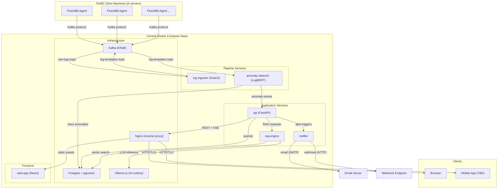
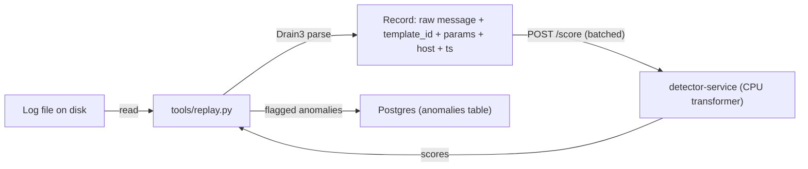
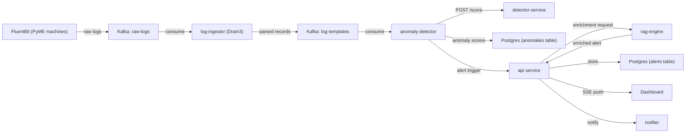
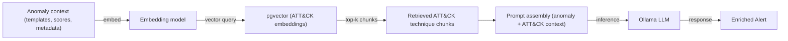
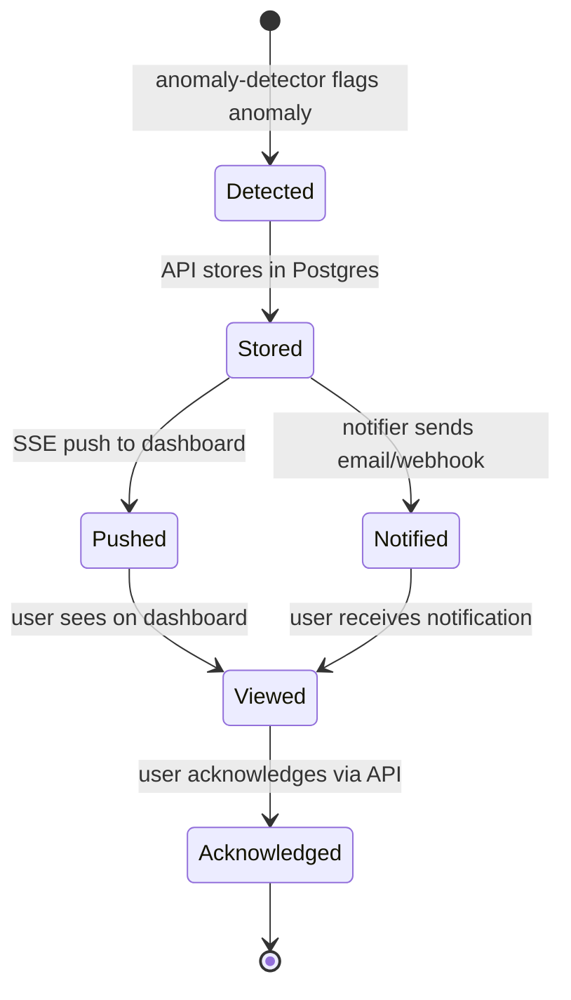

# Anomaly Watch — Architecture

**Anomaly Watch** is a self-hosted, microservices-based log anomaly detection platform designed for PyMEs (small and medium enterprises). It collects logs from client machines, applies ML-based anomaly detection, and generates enriched alerts with MITRE ATT&CK-mapped explanations and contingency actions using a local RAG pipeline.

**Deployment model:** A single Docker Compose stack runs on the PyME's central server. FluentBit agents installed on each PyME machine forward logs to the central stack via Kafka.

**Date of last update:** 2026-08-24

---

## Table of Contents

- [1. System Architecture Diagram](#1-system-architecture-diagram)
- [2. Service Catalog](#2-service-catalog)
  - [2.1 Infrastructure Services](#21-infrastructure-services)
  - [2.2 Pipeline Services](#22-pipeline-services)
  - [2.3 Application Services](#23-application-services)
  - [2.4 Frontend](#24-frontend)
- [3. Data Pipeline](#3-data-pipeline)
  - [3.1 Pipeline Flow Diagram](#31-pipeline-flow-diagram)
  - [3.2 Kafka Topic Structure](#32-kafka-topic-structure)
  - [3.3 Drain3 Template Extraction](#33-drain3-template-extraction)
  - [3.4 Anomaly Detection Model](#34-anomaly-detection-model)
  - [3.5 Model Lifecycle](#35-model-lifecycle)
- [4. RAG Response Engine](#4-rag-response-engine)
  - [4.1 RAG Pipeline Flow](#41-rag-pipeline-flow)
  - [4.2 MITRE ATT&CK Knowledge Base Ingestion](#42-mitre-attck-knowledge-base-ingestion)
  - [4.3 Enriched Alert Structure](#43-enriched-alert-structure)
  - [4.4 LLM and Embedding Models](#44-llm-and-embedding-models)
- [5. Real-Time Alerts & Notifications](#5-real-time-alerts--notifications)
  - [5.1 SSE Real-Time Updates](#51-sse-real-time-updates)
  - [5.2 Notification Channels](#52-notification-channels)
  - [5.3 Alert Lifecycle](#53-alert-lifecycle)
- [6. Auth & Security](#6-auth--security)
  - [6.1 Authentication](#61-authentication)
  - [6.2 RBAC Roles](#62-rbac-roles)
  - [6.3 Security Considerations](#63-security-considerations)
- [7. Infrastructure & Deployment](#7-infrastructure--deployment)
  - [7.1 Docker Compose Topology](#71-docker-compose-topology)
  - [7.2 FluentBit Agent Deployment](#72-fluentbit-agent-deployment)
  - [7.3 Development Environment](#73-development-environment)
- [8. Data Stores](#8-data-stores)
  - [8.1 Postgres Schema Areas](#81-postgres-schema-areas)
  - [8.2 pgvector for ATT&CK Embeddings](#82-pgvector-for-attck-embeddings)
  - [8.3 Log Retention Policy](#83-log-retention-policy)
- [9. TBD Items](#9-tbd-items)
- [10. Glossary](#10-glossary)

---

## 1. System Architecture Diagram

C4-style system context diagram showing all major components and their interactions:



**Protocol legend:**
- **Kafka protocol** — FluentBit → Kafka, inter-service messaging
- **REST** — API ↔ frontend clients, API ↔ rag-engine
- **SSE** — API → frontend clients (real-time push)
- **Internal** — rag-engine ↔ Ollama, rag-engine ↔ Postgres (pgvector)
- **SMTP/HTTP** — notifier → email servers / webhook endpoints

---

## 2. Service Catalog

### 2.1 Infrastructure Services

| Service | Technology | Responsibility | Default Port |
|---------|-----------|---------------|-------------|
| **kafka** | Apache Kafka (KRaft mode, no ZooKeeper) | Message broker for inter-service log pipeline communication | 9092 |
| **postgres** | PostgreSQL + pgvector extension | Primary data store for templates, anomalies, alerts, users, and ATT&CK embeddings | 5432 |
| **nginx** | Nginx | Reverse proxy, TLS termination, static file serving for web-app | 80 / 443 |
| **ollama** | Ollama | Local LLM runtime for RAG inference. Runs as container, serves model via HTTP API | 11434 |

### 2.2 Pipeline Services

| Service | Technology | Responsibility | Default Port |
|---------|-----------|---------------|-------------|
| **log-ingestor** | Python / Drain3 | Consumes raw logs from Kafka, extracts parameterized log templates using Drain3 algorithm, publishes records to Kafka | — (consumer) |
| **anomaly-detector** | Python | Consumes parsed records from Kafka and calls `detector-service` to score them. Holds no model of its own — it owns threshold policy, deduplication and alert triggering | — (consumer) |
| **detector-service** | Python / FastAPI + transformers | Serves the anomaly model over HTTP (`POST /score`). CPU inference. The one component that loads model weights | 8003 (internal) |

> **Demo-phase note.** `anomaly-detector` does not exist yet. During the demo
> phase its role is played by `tools/replay.py`, which reads a log file, parses
> it with Drain3, and calls `detector-service` directly — no Kafka. See §3.1.

### 2.3 Application Services

| Service | Technology | Responsibility | Default Port |
|---------|-----------|---------------|-------------|
| **api** | Python / FastAPI | REST API + SSE endpoints. Central gateway for frontend, alert management, user auth, and coordination with rag-engine | 8000 |
| **rag-engine** | Python / pgvector + Ollama | RAG pipeline: embeds anomaly context, searches pgvector for MITRE ATT&CK matches, sends prompt to Ollama LLM, returns enriched alert | 8001 |
| **notifier** | Python | Notification dispatch service. Sends alerts via email (SMTP) and webhook (HTTP POST). Additional channels TBD | 8002 |

### 2.4 Frontend

| Service | Technology | Responsibility | Default Port |
|---------|-----------|---------------|-------------|
| **web-app** | React | Real-time anomaly dashboard. Receives SSE events for live updates, displays alerts, ATT&CK mappings, and contingency plans | 3000 (dev) |
| **mobile app** | **TBD** (React Native / Flutter / PWA+Capacitor) | Mobile interface for alert monitoring and acknowledgment | TBD |

---

## 3. Data Pipeline

### 3.1 Pipeline Flow Diagram

**Demo path (implemented today).** No broker. This exists so the model layer can
be measured before the streaming design is committed to — the batch size and
latency numbers it produces are the inputs that should size the Kafka topology,
not the other way around.



**Target topology (deferred).** Unchanged in intent from the original design;
the detection box is now a call to `detector-service` rather than an embedded
model. Deferred to its own change — see §9.



### 3.2 Kafka Topic Structure

| Topic | Producer | Consumer | Payload |
|-------|----------|----------|---------|
| `raw-logs` | FluentBit agents | log-ingestor | Raw log lines with metadata (source host, timestamp, log level) |
| `log-templates` | log-ingestor | anomaly-detector | Parameterized log templates with template ID, cluster ID, and extracted parameters |

Additional topics may be added as the system evolves (e.g., `anomaly-events` for decoupling detection from alerting).

### 3.3 Drain3 Template Extraction

The **log-ingestor** service uses the [Drain3](https://github.com/logpai/Drain3) algorithm to parse raw log messages into parameterized templates. Drain3 uses a fixed-depth tree structure for efficient online log parsing.

**Example:**

| Stage | Content |
|-------|---------|
| **Raw log** | `2026-06-07 14:23:01 INFO User admin logged in from 192.168.1.50` |
| **Extracted template** | `User <*> logged in from <*>` |
| **Parameters** | `["admin", "192.168.1.50"]` |

Template extraction gives every record a stable identity for grouping,
deduplication and RAG context.

**What gets scored is the raw message, not the template ID.** The detection model
is a pretrained language model; feeding it opaque cluster IDs would discard the
pretraining that makes it useful without training. Drain3 metadata travels
alongside the message, it does not replace it.

### 3.4 Anomaly Detection Model

The **detector-service** runs a fine-tuned open-weight transformer classifier.

> **LogBERT was dropped.** The original design called for training
> [LogBERT](https://arxiv.org/abs/2103.04475) in-house. That is a research
> project — labeled corpus, training pipeline, GPU budget — and it blocked every
> downstream component behind a model that did not exist. Fine-tuning an existing
> open-weight encoder reaches a usable signal in hours on public data. LogBERT
> remains valid prior art and could return later as one implementation behind the
> `/score` contract; it is not the mechanism.

**Model contract**

| Aspect | Value |
|---|---|
| Framing | Per-line binary classification: raw message → anomaly probability in `[0,1]` |
| Baseline (phase 0) | [`AungMoonLord/bert-log-anomaly-detection`](https://hf.co/AungMoonLord/bert-log-anomaly-detection), apache-2.0, zero training |
| Fine-tune base | [`answerdotai/ModernBERT-base`](https://hf.co/answerdotai/ModernBERT-base), apache-2.0, 8k context |
| Training corpus | LogHub 2.0 BGL, per-line alert labels ([`bolu61/loghub_2`](https://hf.co/datasets/bolu61/loghub_2)) |
| Inference | CPU only, batched. No GPU at the PyME site |
| Threshold | Configuration (`DETECTOR_THRESHOLD`), not a constant. Raw score always returned so consumers can re-threshold without re-scoring |
| Active pin | `ml/models.yaml` — repo ID **and** exact revision SHA |

**Two traps this design guards against**, both found empirically and both cheap
to fall into again:

1. **Label-index inversion.** The phase-0 baseline checkpoint ships no
   `id2label`. Assuming the usual "index 1 = positive" convention inverts every
   score it produces — verified: it scored 0.975 on a routine `systemd` line and
   0.015 on a kernel panic. The correct index is recorded per-model in
   `ml/models.yaml` and reported by `GET /model`. Our own fine-tunes write
   `id2label` into `config.json` so the ambiguity cannot recur.

2. **Label leakage from the severity field.** BGL lines carry a `Level` field
   that is very nearly the label itself (`FATAL` → ~94% anomaly, `INFO` → 100%
   normal). Training or evaluating on text containing it yields a near-perfect
   score that reflects reading one word. Only the `Content` field is scored;
   `Level` is metadata. A `level-keyword` baseline is evaluated on every run so
   the shortcut stays visible if it ever creeps back in.

**Inference flow:**
1. Receive a batch of parsed records (raw message + Drain3 metadata)
2. Tokenize the raw messages
3. Run CPU inference, take the anomaly-class probability
4. Compare against the configured threshold → flag → trigger the alert pipeline
5. Persist score, threshold, model key and model revision with each anomaly, so a
   stored anomaly stays interpretable after a model swap

### 3.5 Model Lifecycle

Models are pinned, evaluated and promoted through a fixed sequence. The point is
that swapping a model costs one config value and a benchmark run.

| Stage | Tool | Output |
|---|---|---|
| Pin & fetch | `ml/download_models.py` | Weights in a local cache; exact revision SHA written to `ml/models.yaml` |
| Dataset | `ml/data/prepare.py` | Chronologically split, labeled JSONL + a manifest hash |
| Evaluate | `ml/eval/harness.py` | Precision / recall / F1 / PR-AUC / p95 latency / model size, per candidate |
| Fine-tune | `ml/train/finetune.py` | Checkpoint + full run metadata |
| Promote | `ml/promote.py` | Gate decision; on pass, updates `default:` in `ml/models.yaml` |

**Rules that hold regardless of which model is active:**

- Revisions are commit SHAs, never branch names — a moved branch means the model
  you evaluated is not the model you deployed.
- The deployed stack runs `HF_HUB_OFFLINE=1`. No runtime downloads, so log data
  cannot egress and the served weights are exactly the evaluated weights.
- Only permissively licensed weights (apache-2.0 / MIT) — the stack is
  redistributed to self-hosting customers.
- **Promotion gate:** a candidate must beat the incumbent *and* both floor
  baselines on F1, on the same dataset manifest, without exceeding the p95
  batch-32 latency budget. Comparing numbers from different data is refused
  automatically.
- Splits are chronological. A random split lets a burst's start land in train and
  its tail in test, which inflates every metric.

---

## 4. RAG Response Engine

### 4.1 RAG Pipeline Flow

When an anomaly is detected, the RAG engine enriches the alert with explanations and contingency plans:



**Flow steps:**
1. **Anomaly context** — anomaly-detector provides the anomaly description, involved log templates, anomaly score, and source metadata
2. **Embedding** — anomaly context is embedded into a vector representation
3. **pgvector search** — similarity search against MITRE ATT&CK embeddings in Postgres, returning top-k most relevant technique/tactic chunks
4. **Prompt assembly** — anomaly context + retrieved ATT&CK chunks are combined into a structured prompt
5. **LLM inference** — Ollama generates an explanation including ATT&CK technique mapping and suggested contingency actions
6. **Enriched alert** — structured response is returned to the API for storage and delivery

### 4.2 MITRE ATT&CK Knowledge Base Ingestion

The MITRE ATT&CK framework data is ingested into pgvector for retrieval:

1. **Source** — MITRE ATT&CK Enterprise matrix (techniques, tactics, procedures)
2. **Chunking** — Each technique/sub-technique is split into chunks (description, detection guidance, mitigations)
3. **Embedding** — Chunks are embedded using a sentence transformer model
4. **Storage** — Embeddings stored in Postgres using the `pgvector` extension with IVFFlat or HNSW indexing
5. **Update cadence** — Re-ingestion on MITRE ATT&CK version updates (manual trigger)

### 4.3 Enriched Alert Structure

Each enriched alert produced by the RAG pipeline contains:

| Field | Description |
|-------|-------------|
| `anomaly_description` | Human-readable summary of what was detected (templates, scores, affected hosts) |
| `attack_techniques` | List of matched MITRE ATT&CK techniques with IDs (e.g., T1078 — Valid Accounts) |
| `attack_tactics` | Associated tactics (e.g., Initial Access, Persistence) |
| `contingency_actions` | Suggested remediation/response steps generated by the LLM |
| `confidence_score` | Anomaly detection confidence (from LogBERT) |
| `source_logs` | Reference to original log template sequence that triggered detection |

### 4.4 LLM and Embedding Models

**Embedding model (decided):** [`nomic-ai/modernbert-embed-base`](https://hf.co/nomic-ai/modernbert-embed-base)

- apache-2.0, **768 dimensions** — this fixes the `pgvector` column width (§8.2)
- Same ModernBERT family as the detector, so one architecture and one tokenizer
  story across the stack
- Pinned in `ml/models.yaml` under the `rag-embed` key, same rules as every other
  model

**Generation model:** still **TBD** — candidates include Mistral 7B and Llama 3.
Selection criteria unchanged: runs on consumer hardware, follows instructions,
produces coherent security analysis.

One candidate worth noting:
[`B4lt/gemma4-loghub-e2b-GGUF`](https://hf.co/B4lt/gemma4-loghub-e2b-GGUF) is a
Gemma-4 E2B fine-tuned on LogHub, distributed as GGUF, so it runs on the Ollama
service the stack already has. It was evaluated for *detection* and rejected —
generation is orders of magnitude slower per line than an encoder and yields no
clean probability to threshold on. For *explanation*, which is what this section
is about, those objections do not apply and it remains a live option.

---

## 5. Real-Time Alerts & Notifications

### 5.1 SSE Real-Time Updates

The **api** service exposes Server-Sent Events (SSE) endpoints for pushing real-time updates to connected clients:

- **Endpoint:** `GET /api/v1/events/stream` (authenticated, role-based)
- **Events pushed:** new anomaly alerts, alert status changes, system health updates
- **Clients:** React web dashboard and mobile app subscribe to SSE stream
- **Reconnection:** clients implement automatic reconnection with exponential backoff
- **No WebSocket needed** — SSE is unidirectional (server → client), simpler than WebSocket for this use case

### 5.2 Notification Channels

The **notifier** service dispatches alert notifications through:

| Channel | Protocol | Status | Details |
|---------|----------|--------|---------|
| **Email** | SMTP | Planned | Configurable SMTP server, alert digest with ATT&CK mapping and contingency actions |
| **Webhook** | HTTP POST | Planned | JSON payload to configurable endpoint (e.g., Slack, Teams, PagerDuty integration) |
| **Additional channels** | — | **TBD** | SMS, push notifications, or other integrations based on PyME needs |

### 5.3 Alert Lifecycle



1. **Detected** — anomaly-detector flags a log sequence as anomalous
2. **Stored** — API stores the alert (with RAG enrichment) in Postgres
3. **SSE push** — API pushes event to connected dashboard clients
4. **Notification** — notifier sends email/webhook to configured recipients
5. **Acknowledged** — user acknowledges the alert through the dashboard or API

---

## 6. Auth & Security

### 6.1 Authentication

- **Mechanism:** JWT (JSON Web Tokens) for stateless authentication
- **Password storage:** bcrypt hashing (no plaintext, no reversible encryption)
- **Token flow:** login → validate credentials → issue JWT → client includes JWT in `Authorization: Bearer <token>` header
- **Token expiration:** configurable (e.g., 24h access token, 7d refresh token)
- **No external OAuth providers** — self-contained auth for self-hosted deployment simplicity

### 6.2 RBAC Roles

| Role | Dashboard | Alerts | Reports | User Management | System Config |
|------|-----------|--------|---------|----------------|---------------|
| **admin** | ✅ Full access | ✅ Manage all | ✅ Generate | ✅ Create/edit/delete users | ✅ Full configuration |
| **analyst** | ✅ Full access | ✅ Manage assigned | ✅ Generate | ❌ | ❌ |
| **viewer** | ✅ Read-only | ✅ Read-only | ❌ | ❌ | ❌ |

Roles are stored in Postgres in a `roles` / `user_roles` table structure. Role checks enforced at API middleware level.

### 6.3 Security Considerations

| Area | Approach |
|------|----------|
| **Data in transit** | TLS termination at Nginx. All external traffic encrypted via HTTPS. Internal services communicate over Docker network (not exposed externally) |
| **Data privacy** | Log data stays entirely on the PyME's own network/infrastructure. No cloud egress. Self-hosted model ensures data sovereignty |
| **API authentication** | All API endpoints require valid JWT (except login/register). Rate limiting at Nginx |
| **Secret management** | Environment variables / Docker secrets for DB credentials, JWT secret, SMTP credentials |
| **Network isolation** | Docker Compose internal network. Only Nginx port (80/443) exposed to host. All other services internal-only |

---

## 7. Infrastructure & Deployment

### 7.1 Docker Compose Topology

All services (except FluentBit agents) run in a single Docker Compose stack on the PyME's central machine:

| Service | Image | Exposed Port | Notes |
|---------|-------|-------------|-------|
| **nginx** | nginx:alpine | 80, 443 | Reverse proxy, TLS termination |
| **kafka** | confluentinc/cp-kafka (KRaft) | 9092 (internal) | No ZooKeeper, KRaft consensus |
| **postgres** | postgres + pgvector | 5432 (internal) | pgvector extension pre-installed. **Currently implemented** as `postgres:16-alpine` (no pgvector yet — nothing uses it until the RAG engine exists), with host bindings on `127.0.0.1` instead of fully internal, see below |
| **ollama** | ollama/ollama | 11434 (internal) | LLM model runtime |
| **log-ingestor** | custom (Python) | — | Kafka consumer, no HTTP port |
| **anomaly-detector** | custom (Python) | — | Kafka consumer, calls detector-service |
| **detector-service** | custom (Python/FastAPI) | 8003 (internal) | CPU inference. Model cache mounted read-only as a volume; `HF_HUB_OFFLINE=1` |
| **api** | custom (Python/FastAPI) | 8000 (internal) | Behind Nginx |
| **rag-engine** | custom (Python) | 8001 (internal) | Called by API |
| **notifier** | custom (Python) | 8002 (internal) | Called by API |
| **web-app** | custom (React, static build) | — | Served by Nginx |

All custom services share a common Docker network. Only Nginx ports are exposed to the host.

**Currently implemented.** `docker-compose.yml` in the repo contains the demo
slice only — `postgres` and `detector`, plus a `replay` service (the demo
transport, under the `tools` profile, not started by `up`). The rest of this
table is the target state; those services have no implementation yet and
shipping empty containers would misrepresent what works. Model weights are **not**
baked into the detector image: they are mounted from `./models/cache`, so the
image stays small and a model swap never requires a rebuild.

The compose project is named `anomaly-watch-ml` so it coexists with the
`Anomaly-Watch` product stack on the same host in either start order, without
colliding on container names, networks, volumes or host ports. Unlike the
target table above (only Nginx exposed to the host), the demo-phase stack
publishes `detector` and `postgres` to `127.0.0.1` — a developer needs both
reachable from the host — on `8003` and `5433` respectively, configurable via
`ML_DETECTOR_PORT` / `ML_POSTGRES_PORT`. `5433`, not `5432`: the product
stack's Postgres already owns `5432` on the same host. See
[README.md](README.md#levantar-con-docker) for the full port table and the
`.env` setup.

Populate the cache before first run:

```bash
uv run python ml/download_models.py
```

### 7.2 FluentBit Agent Deployment

FluentBit runs **outside** the Docker Compose stack, installed directly on each PyME client machine:

- **Installation:** FluentBit installed as a system service on each monitored machine
- **Configuration:** Separate FluentBit config pointing to the central Kafka broker address
- **Input plugins:** tail (log files), systemd (journal), or other source-specific plugins
- **Output plugin:** Kafka output — forwards raw logs to `raw-logs` topic
- **Managed separately** from the central stack (different deploy lifecycle)

### 7.3 Development Environment

Local development uses **Distrobox** with an Ubuntu-based container:

- **Container:** `ubuntu-dev` (image: `quay.io/toolbx/ubuntu-toolbox:latest`)
- **Pre-installed packages:** git, vim, tmux, build-essential, curl, wget, python3, python3-pip, nodejs, npm
- **Additional tooling:** [uv](https://github.com/astral-sh/uv) (installed via init hook) for fast Python package management
- **Config:** `.distrobox/distrobox.ini` at project root
- **Usage:** `distrobox assemble create` to create the dev container, `distrobox enter ubuntu-dev` to start developing

---

## 8. Data Stores

### 8.1 Postgres Schema Areas

Postgres is the sole relational data store. Schema is organized into logical areas:

| Schema Area | Key Tables | Purpose |
|-------------|-----------|---------|
| **Templates** | `log_templates`, `template_clusters` | Drain3-extracted log templates and their cluster metadata |
| **Anomalies** | `anomalies`, `anomaly_scores` | Detected anomalies with model scores and source records |
| **Alerts** | `alerts`, `alert_enrichments` | Alert records with RAG-enriched explanations, ATT&CK mappings, contingency actions |
| **Users & Roles** | `users`, `roles`, `user_roles` | User accounts, RBAC role definitions, and role assignments |
| **Configuration** | `system_config`, `notification_config` | System-wide and per-channel notification configuration |

**The `anomalies` table records which model produced each score:**

| Column | Purpose |
|---|---|
| `message` | The raw log line that was scored |
| `template_id`, `template` | Drain3 identity, for grouping and RAG context |
| `host`, `log_timestamp` | Source machine and the timestamp as originally written |
| `score` | Raw model output in `[0,1]`, stored unthresholded |
| `threshold` | The threshold in force when the row was written |
| `model_key`, `model_revision` | Which model, at which exact revision |

Storing `model_key` / `model_revision` / `threshold` alongside the score is what
keeps historical anomalies interpretable across a model swap. A bare score from
an unknown model is not evidence of anything, and re-thresholding old data
without re-scoring it is only possible because the raw score is kept.

### 8.2 pgvector for ATT&CK Embeddings

- **Extension:** `pgvector` enabled in same Postgres instance (no separate vector DB)
- **Table:** `attack_embeddings` stores MITRE ATT&CK technique/tactic chunks as vector embeddings
- **Index:** IVFFlat or HNSW index for approximate nearest neighbor search
- **Query:** rag-engine performs `ORDER BY embedding <=> query_vector LIMIT k` for top-k retrieval
- **Dimensionality:** **768** — fixed by the choice of `nomic-ai/modernbert-embed-base` (§4.4). Column type is `vector(768)`

### 8.3 Log Retention Policy

- **Retention period:** 1 year for raw log data and templates
- **Strategy:** Postgres table partitioning by month (e.g., `log_templates_2026_01`, `log_templates_2026_02`, ...)
- **Pruning:** Automated job drops partitions older than 12 months
- **Anomaly/alert data:** retained indefinitely (much smaller volume than raw logs)
- **Rationale:** 1-year retention balances compliance needs with storage constraints on PyME infrastructure

---

## 9. TBD Items

### Resolved

| Item | Resolution |
|------|-----------|
| **LogBERT training infrastructure** | **Closed — no longer applicable.** LogBERT was dropped (§3.4). Fine-tuning targets a single consumer GPU or a free-tier T4; inference is CPU-only, so PyMEs never need GPU hardware |
| **Embedding model for RAG** | **Closed.** `nomic-ai/modernbert-embed-base`, 768 dims, apache-2.0 (§4.4). Fixes the pgvector column at `vector(768)` |

### Open

| Item | Context | Impact |
|------|---------|--------|
| **Mobile app framework** | React Native, Flutter, or PWA+Capacitor | Determines mobile dev stack and code sharing with web-app |
| **LLM model for RAG generation** | Mistral 7B, Llama 3, or `B4lt/gemma4-loghub-e2b-GGUF` | Affects hardware requirements (RAM/VRAM) and response quality |
| **Additional notification channels** | SMS, push notifications, chat integrations | Extends notifier service beyond email/webhook |
| **Anomaly detection threshold** | Now a configured value (`DETECTOR_THRESHOLD`, default 0.5) rather than an unknown. What remains open is the *right* value: it has never been validated against real PyME logs, and no false-positive budget has been agreed for a customer with no dedicated SOC | Sets the false positive/negative trade-off |
| **Log sources and formats** | Syslog, JSON, Windows Event Log, custom per PyME | Determines FluentBit parser configuration — and whether a domain fine-tune is needed, since the current model is trained on HPC logs |
| **Streaming topology** | Kafka wiring deferred until the detector's real batch size and latency are known | Deferred on purpose: those measurements are the inputs to the design |
| **Windowed detection** | Per-line today. Session/window-level is strictly better for real detection quality | ModernBERT's 8k context was chosen so this needs no base-model change |
| **Domain transfer** | Model is trained on BGL (HPC supercomputer logs); PyMEs run nginx, sshd, systemd, Windows | The largest known quality risk. Needs a fine-tune on pilot data |

---

## 10. Glossary

| Term | Definition |
|------|-----------|
| **Drain3** | An online log parsing algorithm that extracts parameterized log templates from raw log messages using a fixed-depth tree. Enables structured analysis of unstructured logs |
| **LogBERT** | A BERT-based model adapted for log anomaly detection via masked-log modeling. **Prior art, not used here.** Training it in-house was the original plan and was dropped: it is a research effort that blocked every downstream component behind a model that did not exist. See §3.4 |
| **ModernBERT** | A 2024 encoder architecture (apache-2.0) with an 8k context window and faster inference than BERT at comparable size. The fine-tuning base for the detector |
| **LogHub** | A public collection of labeled system log datasets (BGL, HDFS, Thunderbird, and others) used across the log-analysis literature. Source of the training and evaluation data |
| **Promotion gate** | The rule a candidate model must clear to become the configured default: beat the incumbent and both floor baselines on F1, on the same dataset manifest, within the p95 latency budget. Enforced by `ml/promote.py` |
| **Label leakage** | When a feature in the input effectively encodes the answer — e.g. a log's severity field being nearly identical to its anomaly label. Produces impressive metrics that mean nothing. See §3.4 |
| **MITRE ATT&CK** | A globally-accessible knowledge base of adversary tactics, techniques, and procedures (TTPs) based on real-world observations. Used here to map detected anomalies to known attack patterns |
| **SSE (Server-Sent Events)** | A server push technology enabling a server to send real-time updates to a client over a single HTTP connection. Used for dashboard live updates |
| **pgvector** | A PostgreSQL extension that adds support for vector similarity search. Used to store and query MITRE ATT&CK embeddings for RAG retrieval |
| **KRaft** | Kafka Raft — Kafka's built-in consensus protocol replacing ZooKeeper for cluster metadata management. Simplifies Kafka deployment |
| **FluentBit** | A lightweight, high-performance log processor and forwarder. Deployed on PyME client machines to collect and ship logs to Kafka |
| **RAG (Retrieval-Augmented Generation)** | A technique combining information retrieval (vector search) with LLM generation. Grounds LLM responses in factual, retrieved context |
| **PyME** | Pequeña y Mediana Empresa (Spanish) — Small and Medium Enterprise. The target audience for Anomaly Watch |
| **Ollama** | A local LLM runtime that makes it easy to run large language models on commodity hardware. Runs as a Docker service |
| **JWT (JSON Web Token)** | A compact, URL-safe token format used for stateless authentication. Encodes user identity and claims |
| **RBAC** | Role-Based Access Control — authorization model where permissions are assigned to roles, and users are assigned roles |
| **bcrypt** | A password hashing algorithm designed to be computationally expensive, making brute-force attacks impractical |